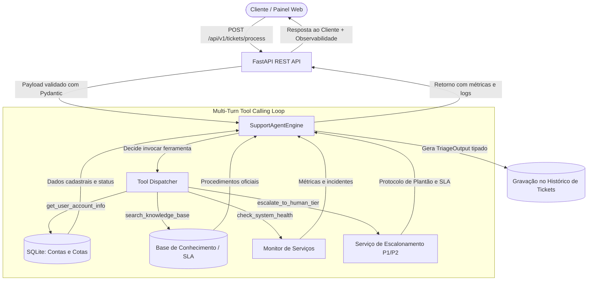

# 🤖 SupportOps AI Agent
### Sistema Autônomo de Triagem e Suporte Técnico com Execução de Ferramentas (Tool Calling) & Google Gemini

[](https://www.python.org/)
[](https://fastapi.tiangolo.com)
[](https://aistudio.google.com/)
[](https://docs.pydantic.dev/)
[](tests/)
[](LICENSE)
[](Dockerfile)

---

## 📌 Visão Geral do Projeto

O **SupportOps AI Agent** é uma solução completa de **Engenharia de Software com Inteligência Artificial** projetada para automatizar o atendimento e a triagem técnica de chamados de suporte corporativo (Nível 1 e 2). 

Diferente de assistentes básicos que apenas geram texto livre sujeito a alucinações, este agente emprega o padrão de **Execução de Ferramentas (Tool / Function Calling)**:
1. **Investiga** o banco de dados de clientes (plano, consumo de cotas de API e pendências financeiras).
2. **Consulta** artigos técnicos e políticas de SLA na base de conhecimento interna.
3. **Monitora** a integridade em tempo real dos microsserviços da infraestrutura.
4. **Escala** chamados críticos para engenheiros humanos de plantão com SLA de 15 minutos quando necessário.
5. **Garante confiabilidade** gerando relatórios de triagem estritamente tipados via **Pydantic v2** (*Structured Outputs*).

---

## 🏗️ Arquitetura do Sistema



---

## 🚀 Diferenciais de Engenharia para Portfólio

| Conceito de Engenharia | Implementação no Projeto |
| :--- | :--- |
| **Tool Calling / Function Calling** | O LLM decide autonomamente quais ferramentas executar via SDK oficial `google-genai`. |
| **Structured Outputs** | Uso de `response_schema` com classes Pydantic v2, eliminando parsing frágil com expressões regulares. |
| **Resiliência e Fallback** | Modo *offline-first* determinístico: caso a chave de API falhe ou as cotas esgotem, o sistema degrada graciosamente sem derrubar a API. |
| **Observabilidade de IA** | Registro de cada passo do raciocínio: ferramentas chamadas, argumentos enviados e saídas retornadas com carimbo de tempo. |
| **Arquitetura em Camadas** | Separação estrita entre camada de API (`main.py`), camada de domínio/agente (`agent/`), ferramentas (`tools/`) e persistência (`database.py`). |
| **Testes Automatizados** | Suíte de 14 testes unitários e de integração cobrindo ferramentas, validação de esquemas e endpoints REST (`pytest`). |
| **Containerização** | `Dockerfile` otimizado pronto para deploy em ambientes Cloud (Google Cloud Run, AWS ECS ou Kubernetes). |

---

## 🛠️ Stack Tecnológica

- **Linguagem:** Python 3.12
- **Framework Web:** FastAPI (com Uvicorn)
- **IA & LLM:** Google AI Studio — Google GenAI SDK (`google-genai`)
- **Validação de Dados:** Pydantic v2 & Pydantic Settings
- **Banco de Dados:** SQLite com SQLAlchemy ORM
- **Testes:** Pytest & HTTPX TestClient
- **Frontend de Demonstração:** HTML5 + Tailwind CSS (integrado ao FastAPI)
- **DevOps:** Docker

---

## 💻 Como Iniciar o Projeto

### Modo 1: Inicialização Rápida com 1 Clique (Windows)
Basta dar **dois cliques no arquivo `iniciar.bat`** na raiz do projeto. 
Ele iniciará o servidor FastAPI e abrirá o painel no navegador automaticamente!

---

### Modo 2: Via Terminal

```bash
# 1. Configurar chave do Google AI Studio no .env
# (Pegue gratuitamente em https://aistudio.google.com/)
GEMINI_API_KEY=sua_chave_aqui

# 2. Iniciar o projeto
.\.venv\Scripts\python.exe run.py
```

- **Painel Interativo:** Acesse [http://127.0.0.1:8000](http://127.0.0.1:8000)
- **Documentação Interativa (Swagger):** Acesse [http://127.0.0.1:8000/docs](http://127.0.0.1:8000/docs)

---

## 🧪 Executando os Testes Automatizados

O projeto inclui uma suíte completa de testes unitários e de integração:

```bash
.\.venv\Scripts\pytest.exe -v
```

Saída esperada:
```text
tests/test_api.py::test_health_check_endpoint PASSED
tests/test_api.py::test_list_users_endpoint PASSED
tests/test_api.py::test_system_status_endpoint PASSED
tests/test_api.py::test_process_ticket_end_to_end PASSED
tests/test_api.py::test_list_tickets_endpoint_after_process PASSED
tests/test_schemas.py::test_valid_ticket_process_request PASSED
tests/test_schemas.py::test_short_message_validation_error PASSED
tests/test_schemas.py::test_valid_triage_output_schema PASSED
tests/test_tools.py::test_search_knowledge_base_finds_rate_limit PASSED
tests/test_tools.py::test_search_knowledge_base_finds_billing PASSED
tests/test_tools.py::test_get_user_account_info_existing_user PASSED
tests/test_tools.py::test_get_user_account_info_non_existing_user PASSED
tests/test_tools.py::test_check_system_health PASSED
tests/test_tools.py::test_escalate_to_human_tier PASSED

======================== 14 passed in 1.30s ========================
```